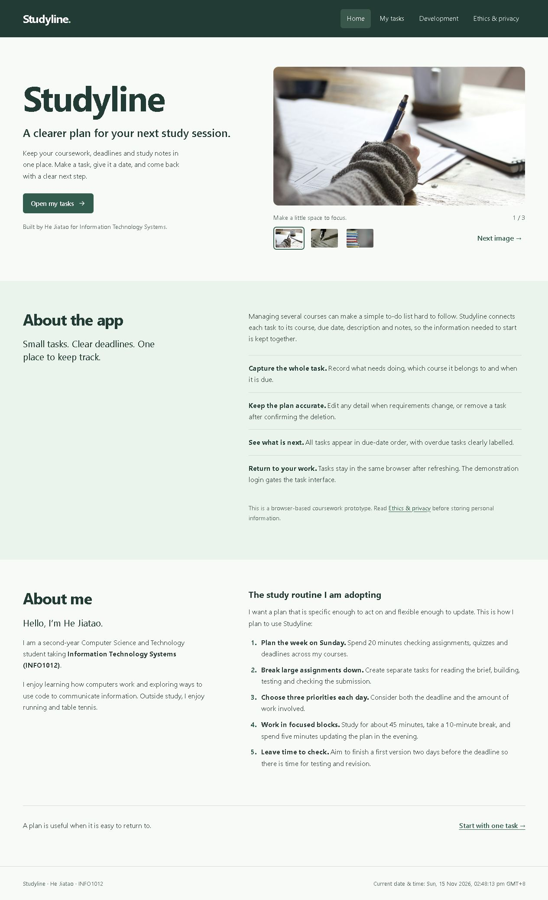
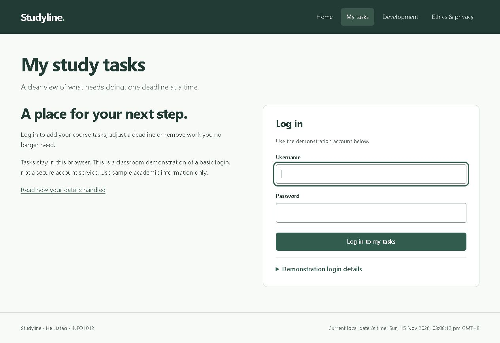
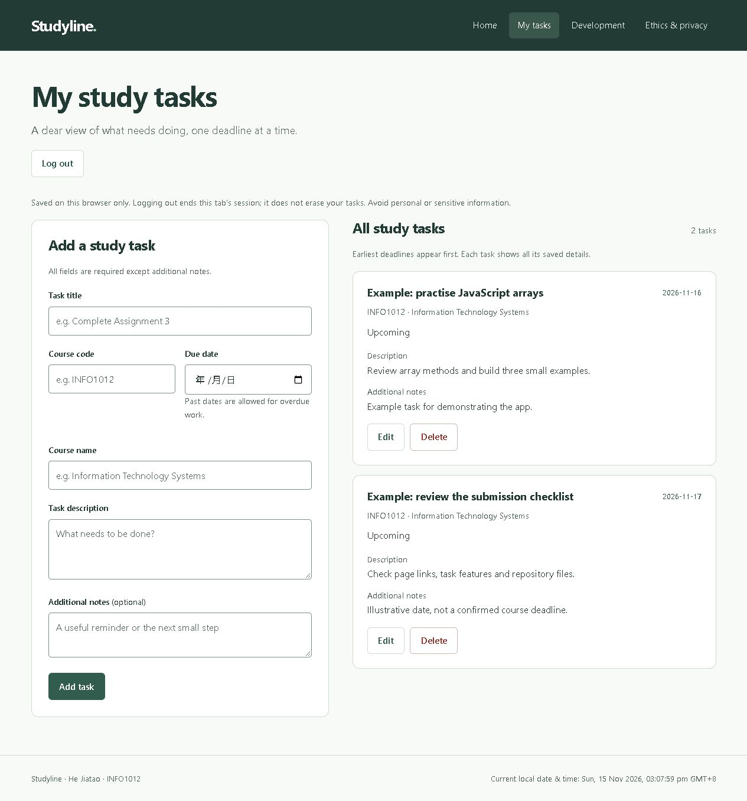
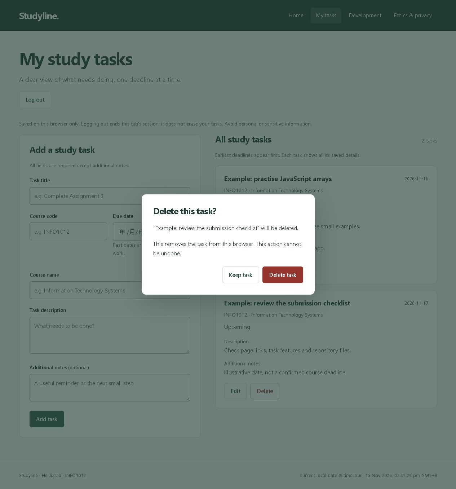
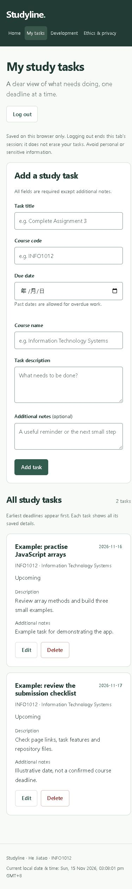

# Studyline

A personal study task manager by **He Jiatao**, developed for **INFO1012 — Information Technology Systems, Assignment 3.1: Web Page Development**.

Project repository: <https://github.com/hejiatao6666-hash/INFO1012-Assignment3>

Studyline brings a task's course, deadline, description and notes together. It is a small, static website built with HTML, CSS and JavaScript, with no framework, build step or application dependencies. The four connected pages explain the application, provide its task manager, document its development, and reflect on ethics and privacy.



## Pages and features

| Page | What it provides |
| --- | --- |
| [Home](src/html/index.html) | Application overview, a personal introduction and study routine, and a three-image gallery controlled by thumbnails and a **Next image** button. |
| [My tasks](src/html/tasks.html) | A demonstration login, validated task creation, a complete task list ordered by deadline, editing, and deletion after confirmation. Tasks persist in the same browser. |
| [Development](src/html/blog.html) | An explanation of selected Agile practices, a proposed three-week project plan, and troubleshooting records with code, screenshots and references. |
| [Ethics & privacy](src/html/ethics.html) | Specific design decisions about data minimisation, validation, access, local storage, user control and the prototype's privacy limitations. |

Navigation connects all four pages. A live clock in the footer uses the device's local date, time and time zone. The layout adapts to desktop and narrow screens, and forms include explicit labels and field-specific error messages.

## Run the website

Use a current version of Chrome, Edge, Firefox or Safari with JavaScript and browser storage enabled.

### Recommended: Visual Studio Code and Live Server

1. Download the repository ZIP using **Code → Download ZIP**, then extract it. Alternatively, clone the project repository.
2. Open the extracted **project folder** in Visual Studio Code. This is the folder containing this README and the root `index.html`.
3. Install the **Live Server** extension by Ritwick Dey if it is not already installed.
4. Right-click the root `index.html` and choose **Open with Live Server**.
5. The root entry page opens `src/html/index.html`. Use the navigation to visit the other pages.
6. Keep using the same browser profile and the same Live Server address and port to return to saved tasks.

There is no `npm install` step. An internet connection is not required while using the downloaded website: the stylesheet, JavaScript and gallery images are included locally.

### Quick alternative: open the files directly

Double-click the root `index.html`. It forwards to the home page, which also has a normal link to the application if automatic forwarding is unavailable. Browser handling of storage under `file://` can vary; if login or saved tasks do not work consistently, use Live Server instead. Moving between `file://` and a local web address, or changing the address or port, can show a different set of browser-stored tasks.

## Demonstration account

| Field | Value |
| --- | --- |
| Username | `student` |
| Password | `Study2026!` |

These are public demonstration credentials. Use sample academic information and do not enter a real account password. This front-end login controls the task interface for a classroom demonstration; it is not a secure account service.

## How to use Studyline

### 1. Explore the home page

Read **About the app** and **About me**. Select **Next image** to cycle through the three study images; after image three, the gallery returns to image one. The thumbnail buttons also select an image directly.

### 2. Log in

Open **My tasks**, enter the demonstration account above, and select **Log in to my tasks**. **Demonstration login details** on that page expands to show the same account. Missing or incorrect credentials produce an explanatory message. Opening the task page directly still displays the login interface unless this tab already has a demonstration session.



### 3. Add a task

Complete the form and select **Add task**. All fields except additional notes are required.

| Field | Input rules |
| --- | --- |
| Task title | Visible text, up to 100 characters. |
| Course code | Up to 20 characters; letters, numbers, spaces and hyphens. Letters are saved in uppercase, for example `info1012` becomes `INFO1012`. |
| Course name | Visible text, up to 120 characters. |
| Due date | A real calendar date with a four-digit year from `0001` to `9999`. Impossible dates are rejected. Past dates are allowed so overdue work can still be recorded. |
| Task description | Visible text, up to 1,000 characters. |
| Additional notes | Optional, up to 1,000 characters. |

Leading and trailing whitespace is removed. Unsupported control characters are rejected. If any value is invalid, the task is not saved, the affected field displays an error, and focus moves to the first field requiring attention. Correct the values and submit the form again.

For a practice task, use a title such as **Review HTML forms**, course code **INFO1012**, course name **Information Technology Systems**, description **Review labels and input validation**, and an optional note such as **Check the tutorial examples**. Choose a suitable future date. This is demonstration content, not a statement of a real course deadline.

### 4. View all task details

The **All study tasks** list shows the task count and every saved field, including description and additional notes. Tasks with the earliest deadlines appear first; ties are ordered by title and then by stable task identifier. A text label identifies each task as **Overdue**, **Due today** or **Upcoming**. Empty notes are shown as **No additional notes**.



### 5. Edit a task

1. Select **Edit** beside the task to change.
2. Its saved details appear in the form, and the heading changes to **Edit study task**.
3. Change any field and select **Save changes**. The same validation rules apply.
4. The task is updated and returns to its correct place in deadline order.
5. To abandon the changes, select **Cancel editing**. The saved task remains unchanged.

Tasks use stable identifiers, so changing their displayed sort order does not change which task is edited.

### 6. Delete a task carefully

Select **Delete** beside the task. A confirmation dialog names the selected task. Select **Keep task**, or press **Escape**, to leave it unchanged. Select **Delete task** to remove it from this browser's saved list. Deletion cannot be undone.



### 7. Return to saved work and log out

Refresh the page to check that saved tasks remain available. Select **Log out** when finished; the workspace closes and the demonstration session marker is removed. Logging out **does not delete saved tasks**. Log in again in the same browser and address to view them.

The footer shows the current local date and time and updates every second. It uses the device clock; it does not request location information.

### 8. Use the website on a smaller screen

The navigation, form and task list reflow for narrow screens. All task details and the edit/delete controls remain available without relying on hover.



The [home page mobile screenshot](assets/screenshots/home-mobile.jpg) shows the gallery and introduction on the same narrow-screen layout.

## Data handling and limitations

- Tasks are saved in this browser's `localStorage`, using the key `studyline.tasks.v1`.
- The demonstration session uses `sessionStorage`, with the key `studyline.demo-session`. The entered password is not saved.
- There is no server, cloud sync, analytics or advertising. The application does not upload task contents.
- Browser storage is **not encrypted**. Someone with access to the same browser profile or developer tools can inspect it. The public front-end credentials can also be inspected or bypassed; this is unsuitable for sensitive data or real authentication.
- On a shared computer, delete sample tasks when finished and clear the website's browser data if required. Logging out alone does not remove the task data.
- Clearing browser data, using a different browser/profile/address, or using a private session can make previous tasks unavailable. There is no recovery service.
- If browser storage is unavailable, a save fails, or stored data cannot be read, the interface shows an error. Unreadable saved data is not silently overwritten with an empty list.
- Displayed task text is inserted with `textContent`, so task content is treated as text rather than executable HTML.

The [Ethics & privacy page](src/html/ethics.html) discusses these trade-offs and the changes a real hosted service would need.

## Project structure

```text
INFO1012-Assignment3/
├── index.html                   # Entry point to the application
├── README.md                    # Project overview and operating instructions
├── LICENSE                      # MIT licence for original project code
├── src/
│   ├── html/
│   │   ├── index.html           # Home and personal introduction
│   │   ├── tasks.html           # Login and task manager
│   │   ├── blog.html            # Plan and troubleshooting blog
│   │   └── ethics.html          # Ethics and privacy reflection
│   ├── css/
│   │   └── style.css            # Shared styles and responsive layout
│   └── js/
│       ├── common.js            # Current date and time
│       ├── home.js              # Three-image gallery
│       └── tasks.js             # Validation, session, storage and task actions
├── assets/
│   ├── images/                  # Three locally stored study photographs
│   ├── screenshots/             # Interface and troubleshooting evidence
│   └── CREDITS.md               # Image sources and their licence information
├── docs/
│   └── ASSESSMENT-MAP.md         # Requirement-to-source/evidence guide
└── tests/
    └── task-logic.test.cjs       # Calendar, validation, sorting and editing checks
```

## Verification

With a current Node.js version installed, the pure task-logic checks can be run from the project folder without installing packages:

```sh
node --test tests/task-logic.test.cjs
```

On **15 November 2026**, all **7 of 7** task-logic tests passed. They cover impossible dates and leap years, required content, input limits, course-code normalisation, invisible-only text, date ordering, stable task identifiers and the local calendar date.

Browser checks on the same date verified:

- Login gating, incorrect-password feedback, successful login, required-field errors, rejection of uppercase expansion beyond the course-code limit, and rejection of an invisible-only title.
- Creating two tasks, deadline sorting, editing the correct task and reordering it, cancelling edits, refresh persistence, keeping a task through the dialog or Escape, and deleting only the confirmed task.
- Rendering sample `` and `<script>` input as text without creating those DOM elements; keeping saved tasks after logout and login.
- All three gallery images and wraparound, thumbnail selection, a clock updating each second, and home/task layouts at a 390-pixel viewport with no horizontal page overflow.

Local integration review also checked the development and privacy pages, navigation between all four pages, the privacy-section link, and local file and image links. The four pages were reviewed at desktop and 390-pixel mobile widths. Input boundaries were darkened for contrast, and evidence images reserve their dimensions to avoid shifting the article while loading. The [assessment map](docs/ASSESSMENT-MAP.md) identifies the relevant source files and screenshot evidence; the [development page](src/html/blog.html) explains the troubleshooting cases.

## Credits and references

- **Project author:** He Jiatao.
- **AI assistance:** OpenAI Codex assisted with interpreting requirements, drafting and refining code and explanatory text, and debugging and checking the application. The project includes this acknowledgement so the assistance is visible rather than presented as unaided work.
- **Photographs:** The three images are downloaded Unsplash photographs. Their source URLs and applicable licence are recorded in [assets/CREDITS.md](assets/CREDITS.md). They are not covered by this project's MIT licence.
- **Open-source review:** [TodoMVC](https://github.com/tastejs/todomvc) was reviewed as an established example of task-oriented interfaces and separation of concerns. Studyline does not copy its application code.
- **Agile:** [Manifesto for Agile Software Development](https://agilemanifesto.org/) and [Principles behind the Agile Manifesto](https://agilemanifesto.org/principles.html).
- **Privacy and security:** [OWASP HTML5 Security Cheat Sheet](https://cheatsheetseries.owasp.org/cheatsheets/HTML5_Security_Cheat_Sheet.html). The website's reflection connects its local-storage guidance to the actual prototype and its limitations.

## Licence

Original project code is available under the [MIT licence](LICENSE), copyright © 2026 He Jiatao. Third-party photographs retain their original terms; see [image credits](assets/CREDITS.md).

## Submission package

The repository URL is included at the start of this README. The assignment submission notice labelled **“updated 15/11/2026”** requires a ZIP exported from the GitHub repository, with the repository URL inside its README or a text file. Download the final pushed repository with **Code → Download ZIP**, and upload that ZIP to Canvas. Check that the archive contains the complete project, this README with the repository URL, screenshots and credits. The repository must contain the same final files as the archive.
